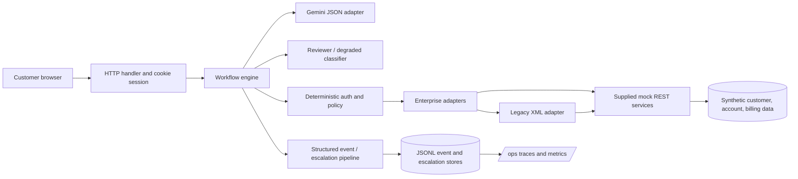

# Architecture

Gemini is used for constrained request interpretation only. `cx/engine.py` owns workflow state and calls narrow adapters; it never exposes arbitrary endpoints or model-selected tool execution. Reviewer and degraded modes replace only intent interpretation while continuing through the same control path. State is held in a process-local session map and is therefore non-durable. Model output does not control customer identity, ownership, confirmation, tool permissions, or result claims.

## Invocation contract

`cx/ai.py::classify` sends a bounded, redacted customer message and JSON response schema. It accepts only a JSON object with an enumerated intent, normalized service enum, validated account identifier and bounded summary. Invalid output and provider errors become a provider failure. Passwords, tokens, emails, phone numbers and enterprise responses are not included in model input. The app invokes Gemini for routing; customer-facing verified response wording is composed deterministically from validated enterprise data.

## Trust boundaries

The browser carries a server-generated, high-entropy HttpOnly, SameSite session cookie. The process maps the opaque identifier to the authenticated synthetic identity and expiry; no client-selected session identifiers are accepted. Authorization runs before the account adapter. Account ownership is checked again against the returned account. Case creation requires an explicit confirmation turn and a time-bucketed idempotency key. Legacy XML is parsed, identity-matched, normalized, and error-mapped before workflow use. Operations APIs require the support-agent role. Events store identifiers and status summaries only, not raw customer text or credentials.

## Gemini CX migration mapping

The challenge forum confirmed that the starter includes no Gemini Enterprise for CX, CX Agent Studio, or Dialogflow CX access. This implementation therefore uses the accessible Gemini API directly; reviewers do not need credentials because all mandatory scenarios run in reviewer mode. The conversational boundary is intentionally separate from policy and enterprise actions.

For a Dialogflow CX deployment, the managed agent and its channels would own turn handling and conversational parameter collection. Dynamic fulfillments would call an HTTPS webhook hosted by this application (or Cloud Run). The webhook would pass a typed request into the existing orchestrator, then map the validated outcome, clarification, or escalation into the CX fulfillment response. CX session parameters can carry conversation state identifiers, but authentication and ownership would remain in the webhook/service policy layer. This aligns with CX's documented API/integration and webhook fulfillment patterns: [Dialogflow CX fulfillment](https://docs.cloud.google.com/dialogflow/cx/docs/concept/fulfillment), [webhooks](https://docs.cloud.google.com/dialogflow/cx/docs/concept/webhook), and [API interaction flow](https://docs.cloud.google.com/dialogflow/cx/docs/quick/api).

The current credential-based REST adapter targets the Gemini API available through Google AI Studio. For a Vertex AI Gemini runtime, replace it with the approved project and location-specific endpoint, ADC/workload identity and managed quotas; retain the same JSON contract and validation boundary. Do not pass enterprise records, authentication secrets, or unrestricted tool definitions to the model. This mapping is a deployment design only; no restricted Gemini CX product is provisioned in this PoC.
